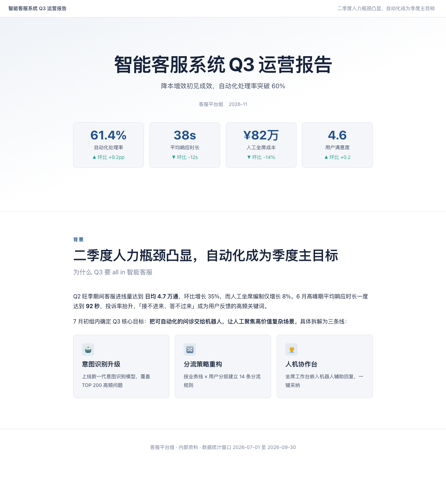
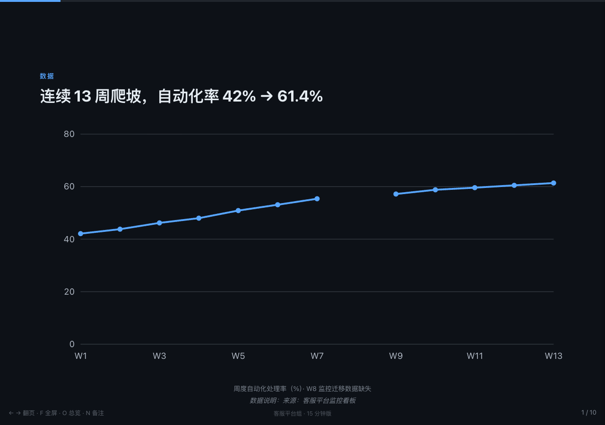

# Visual Report

**An AI-native engine for editable visual reports and slide decks**: turns Markdown and project materials into beautiful **single-file offline HTML** — reports and presentations with charts, architecture diagrams, KPIs and timelines. Double-click to open, works with zero network, email it or print to PDF.

[中文文档](README.md) | [Live report demo](https://linmengmeng-1314.github.io/visual-report/examples/demo-report/output/visual-report.html) | [Live deck demo](https://linmengmeng-1314.github.io/visual-report/examples/demo-deck/output/visual-deck.html)





## Why another generator?

The crowded field of "AI slide skills" shares three weaknesses: font CDNs that break offline use, one-shot generation with no way to revise, and "looks done" output nobody verified. This project is built as a **pipeline with quality gates** instead:

- **Agent writes plans, code renders** — you produce a structured `report-plan.json` / `slide-plan.json` (JSON Schema validated, stable IDs); a deterministic Python renderer turns it into HTML. Same input, same output, every time.
- **Strictly offline** — build-time SVG charts and architecture diagrams (zero JS chart runtime), system font stacks for CJK, everything inlined. Static checks enforce a 2MB target / 5MB hard cap.
- **Three quality gates** — Schema validation → static checks (external resources, anchors, duplicate IDs, weak titles, size budget) → optional Playwright visual inspection (dual-viewport overflow/broken-image detection, per-section screenshots).
- **Continuous revision** — natural-language edits modify the checkpoint plan, not the HTML. `revise.py` handles validate → render → check → snapshot with node-level diffs, history and one-command rollback; a failed render never destroys the last good output.

## Feature highlights

| | |
|---|---|
| **Two modes** | Report (8 layouts, TOC, print) + deck (10 layouts, 1280×720 canvas, native runtime: arrows / F fullscreen / O overview / N speaker notes) |
| **Diagrams** | Declarative grid-coordinate architecture/flow diagrams rendered to static SVG at build time — automatic orthogonal routing with rounded corners (port spreading, crossover halos), semantic node colors (color-mix tokens), pill-backed edge labels, click-to-focus, plus a geometry lint in the validation gate |
| **Charts** | bar / line / donut with multi-series and honest null-gap handling (missing data breaks the line, never fabricated) |
| **Themes** | 5 token-based themes (minimal / corporate / tech / editorial / dashboard); one command renders real previews of all themes to choose from (Show, Don't Tell) |
| **Transform** | `to_slides.py` scaffolds a deck from an existing report — KPIs, charts and diagrams carry over; the agent refines the narrative |
| **Materials** | `extract.py` digests md/txt/csv/json (docx/pdf via optional extras) into a unified material summary with a hash index |

## Quick start

```bash
pip install markdown-it-py jsonschema        # the only two required deps
# uv-managed Python rejects bare pip (PEP 668); use this instead:
# uv pip install --system --break-system-packages markdown-it-py jsonschema

python scripts/validate.py examples/demo-report/report-plan.json   # gate 1
python -m visual_report.render examples/demo-report/report-plan.json \
    -o output/report.html                                           # render
python scripts/static_check.py output/report.html                   # gate 2
```

Use as a Claude Code skill (drop this repo into your skills directory) or with any coding agent — see [AGENTS.md](AGENTS.md).

## Acknowledgments

This project learned from (not copied from) many excellent open-source works — see the full list in the [Chinese README](README.md#致敬优秀开源项目).

## License

MIT
