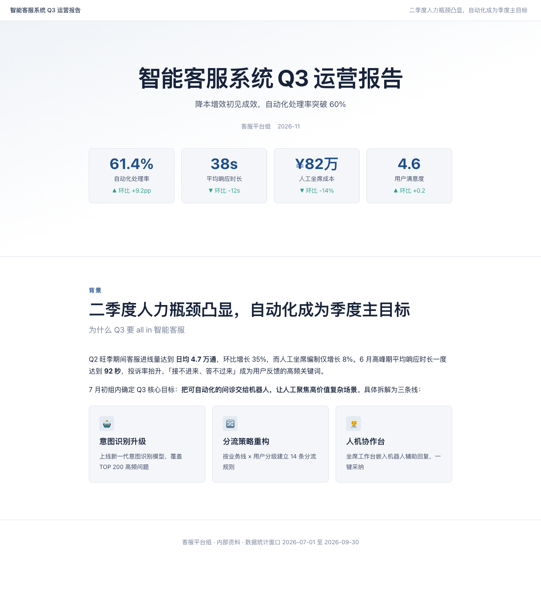
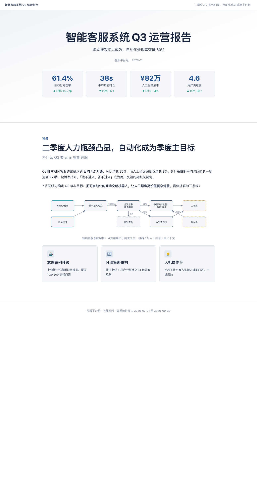
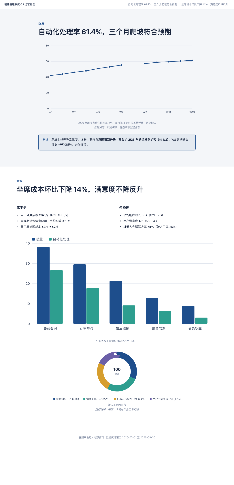

# Visual Report

**AI 驱动的可持续编辑型图文报告生成工具**：把 Markdown 和项目素材变成精美的**单文件离线 HTML 图文报告**——含图表、KPI、时间线、目录导航，双击即可打开，断网可用，可直接邮件发送或打印成 PDF。

> An AI-native visual content engine: structured plans → deterministic rendering → single-file offline HTML reports.







*示例：[examples/demo-report](examples/demo-report/output/visual-report.html)（企业季度运营报告，33KB 单文件，断网可开；架构图/图表均为构建期 SVG）*

## 核心特性

- ✍️ **AI 写计划，程序做渲染**：Agent 产出结构化的 `report-plan.json`（JSON Schema 校验），Python Renderer 确定性渲染——相同输入永远得到相同输出，AI 不直接拼接 HTML
- 📴 **严格离线**：CSS/图表/图片全部内嵌，无 CDN、无在线字体、无运行时依赖；静态检查门禁强制保证（2MB 目标 / 5MB 硬上限）
- 📊 **构建期图表**：柱状图/折线图/环形图在构建时渲染为静态 SVG，零 JavaScript 运行时；缺失数据自动断线呈现，不编造
- 🎨 **Token 化主题**：主题 = 一份 CSS 变量文件，内置 minimal / corporate / tech 三套，图表颜色自动跟随主题
- ✅ **两层质量门禁**：Schema 校验（ID 唯一性、白名单、离线约束）+ 静态检查（外部资源、锚点、重复 ID、弱标题、体积），不过门禁不交付
- 🏷️ **稳定 ID**：每个 section/block 都有 ID，为后续"自然语言定点修改"提供锚点（路线图 Phase 3）

## 快速开始

```bash
pip install markdown-it-py jsonschema   # 仅有的两个依赖

# 用示例跑通全链路
python scripts/validate.py examples/demo-report/report-plan.json          # 第一层：Schema 校验
python -m visual_report.render examples/demo-report/report-plan.json \
    -o output/report.html --base-dir examples/demo-report                # 渲染单文件 HTML
python scripts/static_check.py output/report.html                        # 第二层：静态质检
```

在 Claude Code 中作为 Skill 使用：把本仓库放入 skills 目录（或 `~/.claude/skills/visual-report`），然后：

```
/visual-report 请把当前目录的季度总结 md 生成一份图文 HTML 报告
```

## 工作流

```
素材（Markdown/项目资料）
   ↓ Agent：内容理解与叙事规划
report-plan.json（稳定 ID + 结构化块）
   ↓ scripts/validate.py（必须 PASS）
Python Renderer（布局 + 主题 + 构建期 SVG 图表 + 资源内嵌）
   ↓ scripts/static_check.py（必须非 FAILED）
output/visual-report.html —— 双击打开，断网可用，可打印成 PDF
```

## 支持的块类型

text（Markdown）/ heading / list / quote / callout / code / image（自动 base64 内嵌）/ kpi（含涨跌语义）/ chart（bar·line·donut，支持多序列与缺失值断线）/ table / timeline / cards / columns —— 详见 [references/block-reference.md](references/block-reference.md)。

8 种布局：hero / prose / two-col / cards / kpi / chart-focus / timeline / conclusion。

## 路线图

| 阶段 | 内容 | 状态 |
|---|---|---|
| Phase 1 | 报告生成 MVP（本仓库当前范围） | ✅ 可用 |
| Phase 2 | 更多主题与布局、Mermaid 架构图、风格预览、截图检查 | 开发中 |
| Phase 3 | 自然语言持续修改（改检查点重渲染 + 修改历史） | 规划 |
| Phase 4 | 幻灯片模式、多格式输入（DOCX/PDF/CSV）、报告↔幻灯片转换 | 规划 |

**未实现的功能不在本 README 宣称范围内**（例如幻灯片/演示文稿模式尚未支持）。

## 项目结构

```
├── SKILL.md                    # Agent Skill 入口（工作流与行为规范）
├── references/                 # Agent 按需加载的参考文档
├── schemas/report.schema.json  # 中间格式 Schema（白名单 + ID 规范）
├── visual_report/              # Python Renderer
├── assets/                     # base.css（token 消费）+ themes/（token 定义）
├── scripts/                    # validate.py / static_check.py 质检门禁
├── examples/demo-report/       # 完整示例（含产物与质检报告）
└── tests/                      # pytest（Schema 用例集 + golden-file 渲染基准）
```

## 开发

```bash
python -m venv .venv && .venv/bin/pip install -e ".[dev]"
.venv/bin/pytest                       # 19 个测试
UPDATE_GOLDEN=1 .venv/bin/pytest       # 渲染行为有意变更时更新 golden 基准
```

## License

MIT
